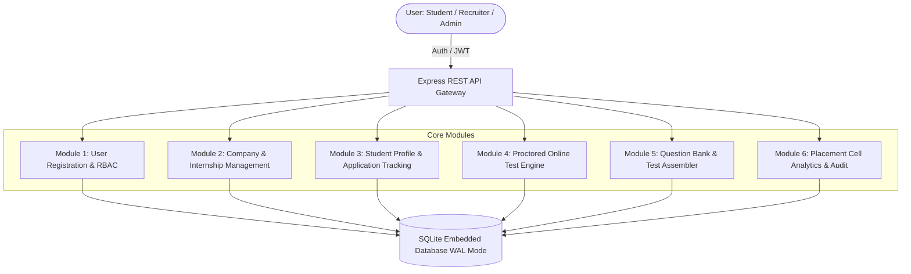
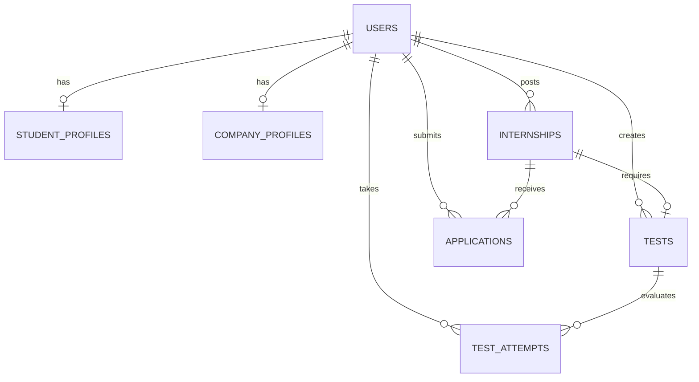

# NextStep: Internship Management with Online Test for Selection

**Software Engineering Project (SEP) &bull; Academic Year 2025-2026**

- **Student Name:** SREEHARI NIKATHIL
- **Register Number:** CCE25CS231
- **Degree & Branch:** B.Tech in Computer Science and Engineering
- **Institution:** College of Engineering

---

## 📋 Project Abstract

Internship recruitment serves as an essential bridge between academic learning and industry experience. **NextStep** is an enterprise-grade, web-based platform designed to streamline internship postings, candidate application pipelines, automated proctored technical assessments, and final selection outcomes.

The platform provides dedicated, role-based workflows for:
1. **Students:** Discover openings, verify CGPA eligibility, upload resumes, take timed proctored online exams with live webcam and tab-switch monitoring, and track application stages in real-time.
2. **Company Recruiters:** Publish detailed internship postings, set minimum CGPA cutoffs, manage categorized technical question banks, assemble tests, evaluate candidates, and issue selection offers.
3. **College Placement Administrators:** Monitor campus placement statistics, audit candidate test performance, verify external recruitment companies, and view department-wise placement conversion analytics.

---

## 🚀 Key Modules & Architecture



### Module 1: User Registration and Authentication
- **Role-Based Access Control (RBAC):** Distinct roles for `ADMIN`, `COMPANY`, and `STUDENT`.
- **Security:** Industry-standard `bcryptjs` password hashing (salt rounds: 10), signed JSON Web Tokens (JWT) with configurable expiration.
- **Viva Demo Switcher:** 1-click role switcher directly in the UI header for fast evaluation during demonstrations without repetitive manual logins.

### Module 2: Company & Internship Management
- **Company Profiles:** Company description, industry tags, headquarters, verified recruiter badges, and HR contacts.
- **Posting Details:** Title, department, duration, stipend, work mode (Remote, Hybrid, On-site), required technical skills, minimum CGPA cutoff, target graduation batches, and allowed engineering disciplines.
- **Test Linkage:** Optional binding of an online screening test to any internship posting.

### Module 3: Student Profile & Application Management
- **Academic Profile:** College Register Number (e.g. `CCE25CS231`), CGPA, graduation batch, branch, phone, bio, and portfolio links.
- **Document Management:** PDF resume upload with server storage and real-time document viewing.
- **Eligibility Gatekeeper:** System validates student CGPA and branch against posting requirements prior to application submission.
- **Application Pipeline Tracker:** Real-time statuses (`APPLIED` &rarr; `SHORTLISTED` &rarr; `TEST_INVITED` &rarr; `TEST_IN_PROGRESS` &rarr; `TEST_COMPLETED` &rarr; `SELECTED` / `REJECTED`) with recruiter notes and feedback.

### Module 4: Proctored Online Test Engine (Flagship Feature)
- **Candidate Assessment Portal:** Distraction-free examination interface designed for desktop browsers.
- **Live Proctoring Safeguards:**
  - **Fullscreen Lock:** Mandatory fullscreen request prior to test launch.
  - **Tab-Switch & Blur Detection:** Listens to `visibilitychange` and window `blur` events. Triggers progressive warning modals (`Warning 1/3`) and automatically disqualifies candidates exceeding the allowed violation threshold.
  - **Right-Click & Clipboard Locking:** Prevents copy-pasting questions and inspecting DOM elements during exams.
  - **Webcam Monitoring Preview:** Real-time camera feed preview with active recording indicator.
- **Interactive Question Palette:** Dynamic color-coded palette showing:
  - 🟢 **Green:** Answered
  - 🟡 **Yellow:** Marked for Review
  - 🔴 **Red:** Visited & Unanswered
  - ⚪ **Gray:** Unvisited
- **Auto-Evaluation Engine:** Objective questions (MCQs) are evaluated instantly on submission. Calculates candidate score, accuracy percentage, pass/fail status against the company's qualification cutoff, and logs all proctoring telemetry.

### Module 5: Question Bank & Test Creation
- **Repository Categorization:** Organized across Computer Science disciplines:
  - *Data Structures & Algorithms*
  - *Web Technologies & Distributed Systems*
  - *Database Management Systems (SQL & ACID)*
  - *Quantitative Aptitude & Logical Deductions*
  - *Python, Core CS & Operating Systems*
- **Difficulty & Tagging:** Easy, Medium, Hard tiers with searchable tags (`#arrays`, `#sql`, `#trees`).
- **Flexible Test Assembly:** Recruiters can assemble tests by manually selecting questions or using automated category distribution templates.

---

## 🛠️ Technology Stack

| Layer | Technologies Used |
| :--- | :--- |
| **Frontend** | React 18, Vite, Tailwind CSS, Lucide React, Canvas Confetti |
| **Backend** | Node.js, Express.js REST API |
| **Database** | SQLite with WAL (Write-Ahead Logging) and Foreign Key constraints |
| **Authentication** | JWT (JSON Web Tokens), bcryptjs |
| **File Storage** | Multer for PDF resume and company logo uploads |

---

## ⚡ Quickstart Guide

### 1. Prerequisites
- Node.js (v18.0.0 or higher)
- npm (v9.0.0 or higher)

### 2. Setup & Database Seeding
Clone the repository and run:
```bash
# Install root dependencies
npm install

# Run database schema migration & realistic seed data
npm run seed
```

### 3. Run Development Servers
```bash
# Starts both Express backend (:5000) and Vite frontend (:5173) concurrently
npm run dev
```

Open your browser at **`http://localhost:5173`** (or `http://localhost:5000` in production mode).

---

## 🔑 Pre-Configured Test Credentials

For effortless examiner demonstration, credentials can be entered manually or launched with **one click** using the top **Viva Demo Switcher**:

| Role | Email | Password | Details |
| :--- | :--- | :--- | :--- |
| **🎓 Student** | `sreehari@college.edu` | `Student@123` | **Sreehari Nikathil** (CCE25CS231 &bull; 8.92 CGPA) |
| **🏢 Recruiter (Google)** | `recruitment@google.com` | `Google@123` | **Google Cloud India** (Verified) |
| **🏢 Recruiter (Zerodha)** | `hiring@zerodha.com` | `Zerodha@123` | **Zerodha Tech** (Verified) |
| **👑 College Admin** | `admin@college.edu` | `Admin@123` | **Dr. K. R. Sharma** (Placement Director) |

---

## 📚 Database Relational Schema



---

## 👨‍💻 Project Developer Information

- **Student Name:** SREEHARI NIKATHIL
- **Register Number:** CCE25CS231
- **Department:** Computer Science and Engineering
- **Project Topic:** Internship Management with Online Test for Selection
